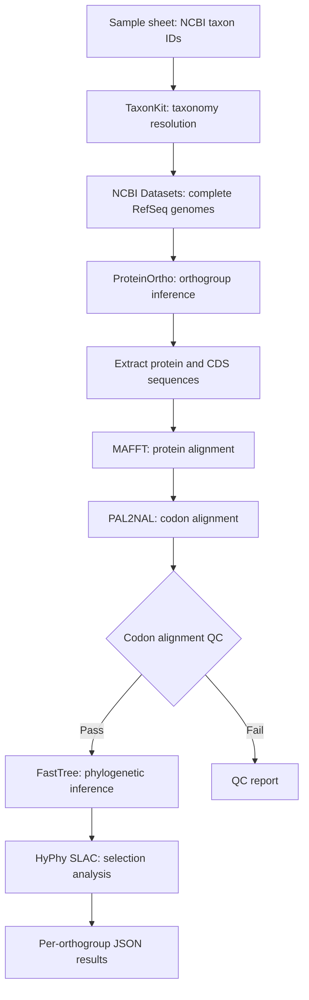

# nf-dnds


[](https://www.nextflow.io/)
[](https://docs.conda.io/)
[](https://www.docker.com/)
[](https://sylabs.io/docs/)

**scbirlab/nf-dnds** is a Nextflow DSL2 pipeline for estimating evolutionary selection across bacterial orthologous genes using codon alignments and phylogenetic analysis.

Given a list of NCBI taxonomy identifiers, it automatically retrieves reference genomes, identifies orthogroups, constructs codon alignments, applies quality filters, and estimates synonymous and nonsynonymous substitution rates using [HyPhy](https://hyphy.org/).

The pipeline is designed for comparative bacterial genomics, including identifying conserved genes and candidates for positive or purifying selection.

**Table of contents**

- [Processing steps](#processing-steps)
- [Requirements](#requirements)
- [Quick start](#quick-start)
- [Inputs](#inputs)
- [Outputs](#outputs)
- [Interpretation](#interpretation)
- [Issues, problems, suggestions](#issues-problems-suggestions)
- [Further help](#further-help)

## Processing steps



1. **Taxonomy resolution:** Resolve each NCBI taxonomy identifier to its species ancestor using TaxonKit, and retrieve taxonomic classifications.
2. **Genome retrieval:** Download complete, current, annotated RefSeq assemblies using NCBI Datasets, excluding MAGs, atypical assemblies and multi-isolate assemblies.
3. **Orthogroup inference:** Identify orthologous protein groups across genomes using ProteinOrtho and extract corresponding protein and coding sequences.
4. **Sequence alignment:** Align proteins with MAFFT and back-translate using PAL2NAL to generate codon-aware nucleotide alignments.
5. **Alignment QC:** Evaluate sequence diversity, alignment length, variable codons and ambiguous bases. Exclude alignments failing the configured thresholds.
6. **Phylogenetic inference:** Infer a nucleotide tree for each passing codon alignment using FastTree with the GTR model.
7. **Selection analysis:** Run HyPhy SLAC on each passing alignment and tree to estimate synonymous and nonsynonymous substitution rates and test for site-level selection.

Each taxonomy identifier is processed independently. Alignment QC reports are retained for both accepted and rejected orthogroups.

## Requirements

### Software

- [Nextflow](https://www.nextflow.io/) (compatible with the version constraint in `nextflow.config`)
- [Conda](https://docs.conda.io/), [Docker](https://www.docker.com/) or [Singularity/Apptainer](https://apptainer.org/)
- Internet access to NCBI Datasets and the NCBI taxonomy database during genome retrieval

The pipeline's dependencies are specified in [`environment.yml`](environment.yml) and [`Dockerfile`](Dockerfile).

For example, on a cluster with environment modules:

```bash
module load Nextflow Singularity
```

Alternatively, install Nextflow using Conda:

```bash
conda install -c bioconda nextflow
```

The `standard` profile is configured for SLURM with Singularity; `local` uses the local executor.

## Quick start

For example, to analyse selection across complete *Escherichia coli* RefSeq genomes, create `sample-sheet.csv`:

```csv
taxon_id
562
```

Then run:

```bash
nextflow run scbirlab/nf-dnds \
    -r dev \
    -profile local \
    --sample_sheet sample-sheet.csv \
    --max_strains 10 \
    --outputs results
```

This retrieves up to 10 genomes for the specified taxon, identifies orthogroups and performs codon-based selection analysis on orthogroups passing QC.

The genome limit is useful for initial experiments. For larger analyses, omit `--max_strains` to use all assemblies returned by the retrieval process.

To run on SLURM using the configured Singularity profile:

```bash
nextflow run scbirlab/nf-dnds \
    -r dev \
    -profile standard \
    --sample_sheet sample-sheet.csv \
    --outputs results
```

To resume an interrupted run, add `-resume`. To update the locally cached pipeline to the latest branch revision, add `-latest`.

For a small test run, the repository includes a test sample sheet and configuration:

```bash
git clone -b dev https://github.com/scbirlab/nf-dnds.git
cd nf-dnds
bash test/run-tests.sh
```

The test configuration limits genome retrieval to five strains and alignment processing to the first 100 orthogroups.

## Inputs

### Sample sheet

The required `--sample_sheet` parameter specifies a CSV file containing one NCBI taxonomy identifier per row.

| taxon_id |
|----------|
| 562 |
| 1280 |
| 1773 |

Taxonomy identifiers may refer to species or descendants of species. The pipeline resolves each identifier to its species ancestor for genome retrieval.

Multiple identifiers are analysed separately.

### Parameters

| Parameter | Default | Description |
|-----------|---------|-------------|
| `--sample_sheet` | Required | CSV containing a `taxon_id` column |
| `--inputs` | `inputs` | Input directory (currently unused by the main workflow) |
| `--outputs` | `outputs` | Output directory |
| `--max_strains` | `false` | Maximum number of genomes per taxon; unset means no explicit limit |
| `--pvalue` | `0.05` | Significance threshold for HyPhy SLAC |
| `--test` | `false` | Process only the first 100 orthogroups through MAFFT |
| `--min_sequences` | `3` | Minimum sequences per codon alignment |
| `--min_unique_sequences` | `3` | Minimum distinct sequences |
| `--min_codons` | `20` | Minimum alignment length in codons |
| `--min_variable_codons` | `1` | Minimum variable codons |
| `--max_ambiguous_fraction` | `0.1` | Maximum fraction of ambiguous bases |
| `--taxonkit_db_url` | NCBI taxdump URL | Taxonomy database download URL |

Parameters may be supplied on the command line or in a Nextflow configuration file.

For example, to apply more stringent alignment filtering, create `analysis.config`:

```groovy
params {
    sample_sheet = "sample-sheet.csv"
    outputs = "results"

    max_strains = 50

    min_sequences = 5
    min_unique_sequences = 4
    min_codons = 50
    min_variable_codons = 3
    max_ambiguous_fraction = 0.05

    pvalue = 0.05
}
```

Then run:

```bash
nextflow run scbirlab/nf-dnds \
    -r dev \
    -profile standard \
    -c analysis.config
```

## Outputs

Results are published under `--outputs` (`outputs/` by default).

```text
outputs/
├── taxonkit/
│   └── taxonomy.csv
├── genome/
│   └── <taxon_id>_dataset/
├── orthogroups/
│   ├── <taxon_id>_ortho.proteinortho.tsv
│   └── proteins/
├── alignments/
│   ├── protein/
│   ├── cds/
│   └── trees/
├── qc/
│   └── codon/
└── hyphy/
    └── slac/
```

| Directory | Contents |
|-----------|----------|
| `taxonkit/` | Taxonomic classifications |
| `genome/` | Downloaded genome, protein, CDS, GenBank and GFF files |
| `orthogroups/` | ProteinOrtho assignments and orthogroup FASTA files |
| `alignments/protein/` | MAFFT protein alignments |
| `alignments/cds/` | PAL2NAL codon alignments |
| `alignments/trees/` | FastTree phylogenies in Newick format |
| `qc/codon/` | Per-orthogroup QC assessments, sequence groups and passing alignments |
| `hyphy/slac/` | HyPhy SLAC JSON results |

Published per-orthogroup filenames are prefixed with the taxon and orthogroup identifiers.

### Alignment QC

Each orthogroup produces:

- `assessment.tsv`: alignment QC metrics and eligibility assessment.
- `sequence_groups.tsv`: groups of identical sequences.
- `analysable.fna`: codon alignment retained for phylogenetic and selection analysis, if QC passes.

Only passing alignments proceed to FastTree and HyPhy.

### HyPhy results

HyPhy SLAC produces a JSON result for each analysed orthogroup, containing substitution-rate estimates and site-level selection analyses.

The current `dev` workflow publishes individual SLAC JSON files. Aggregation into a combined gene-level dN/dS table and MultiQC reporting are not yet connected to the main workflow.

## Interpretation

The ratio of nonsynonymous to synonymous substitution rates, commonly denoted ω = dN/dS, is used to describe evolutionary selective pressure:

- **ω < 1:** Consistent with purifying selection.
- **ω ≈ 1:** Consistent with neutral evolution.
- **ω > 1:** Consistent with positive selection.

SLAC additionally tests individual codon sites for evidence of positive or negative selection.

Interpretation requires care, particularly for closely related bacterial genomes with limited synonymous divergence. Low sequence diversity, recombination, alignment errors and orthology errors can influence estimates. The pipeline's alignment filters address some of these limitations but do not replace evolutionary or statistical validation.

Site-level significance thresholds should also be interpreted in light of the number of sites and orthogroups tested.

## Issues, problems, suggestions

Please report bugs, feature requests or questions through the [GitHub issue tracker](https://github.com/scbirlab/nf-dnds/issues).

## Further help

- [Nextflow documentation](https://www.nextflow.io/docs/latest/)
- [NCBI Datasets](https://www.ncbi.nlm.nih.gov/datasets/)
- [TaxonKit](https://bioinf.shenwei.me/taxonkit/)
- [ProteinOrtho](https://www.bioinf.uni-leipzig.de/Software/proteinortho/)
- [MAFFT](https://mafft.cbrc.jp/alignment/software/)
- [PAL2NAL](https://www.bork.embl.de/pal2nal/)
- [FastTree](http://www.microbesonline.org/fasttree/)
- [HyPhy](https://hyphy.org/)

## License

See [LICENSE](LICENSE).
